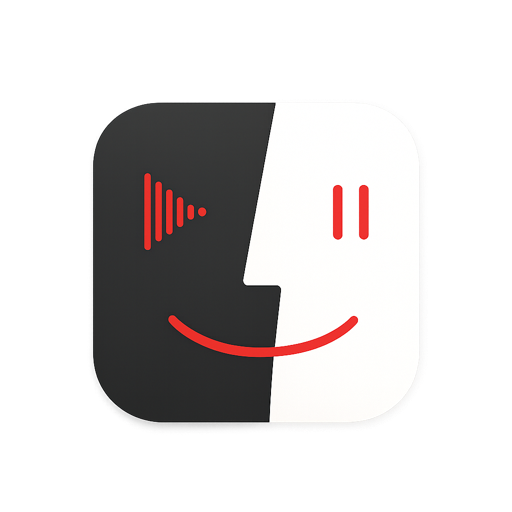
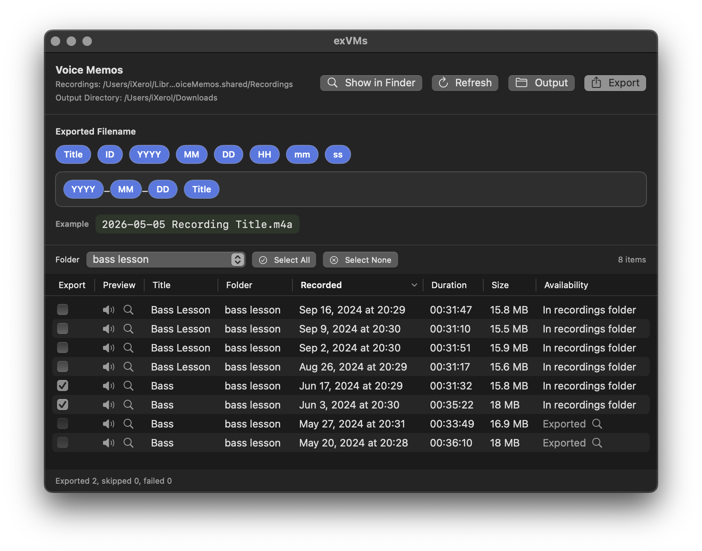

# exVMs


[](https://github.com/iXerol/exVMs/actions/workflows/build.yml)



`exVMs` exports local recordings from Voice Memos.app on macOS.

It can be used as either:

- a Rust CLI
- a local unsandboxed macOS SwiftUI app

The tool reads the active Voice Memos recordings store, lists metadata, and copies local audio files to an output directory without overwriting existing files.



## CLI

Build the CLI:

```sh
cargo build --release --bin exvms --features cli
```

List recordings:

```sh
target/release/exvms view
```

Export selected recordings by the stable `Z_PK` ID shown by `view`:

```sh
target/release/exvms export -o /path/to/export --id 304 --id 305
```

Export all local recordings:

```sh
target/release/exvms export -o /path/to/export -a
```

Use a filename template:

```sh
target/release/exvms export -o /path/to/export -n "{datetime:%Y-%m-%d %H-%M-%S} {title}"
```

Supported template fields are `{id}`, `{title}`, `{date:FORMAT}`, `{time:FORMAT}`, and `{datetime:FORMAT}`. `FORMAT` uses `strftime` / `chrono` directives. The source file extension is appended automatically.

Choose output subdirectories:

```sh
target/release/exvms export -o /path/to/export -a -f d
target/release/exvms export -o /path/to/export -a -f f -f d
```

The `-f, --folder` option accepts `f` for the Voice Memos folder, `d` for the recording date, or `fd` for both. When both are selected, exports use `Voice Memos Folder/YYYY-M-D/Recording.m4a`; recordings without a Voice Memos folder use `No Folder/YYYY-M-D/Recording.m4a`.

Recordings that are missing locally, still need download, or resolve outside the active Voice Memos recordings directory are not exported.

If macOS denies terminal access to Voice Memos data, grant Full Disk Access to the terminal app you use to run `exvms`.

See the [Voice Memos storage paths by macOS version](docs/development.md#voice-memos-stores) if `exvms view` cannot find the database.

## macOS App

The app lists the current Voice Memos storage location and recordings in a table.

Basic flow:

1. Open the app.
2. If prompted, add `exVMs` to System Settings > Privacy & Security > Full Disk Access, then refresh.
3. Choose an output directory. The app remembers this directory for future launches if it still exists.
4. Filter or sort recordings if needed.
5. Preview local recordings with Quick Look if needed.
6. Enable the export checkbox for the recordings you want, or use Select All / Select None.
7. Click Export.

The Export button stays disabled until an output directory exists and at least one exportable, not-yet-exported recording is selected.

Deleted recordings are hidden by default. Enable **Show deleted recordings** in the app's Preferences to include them in the table; they use a dimmed style and a struck-through title.

The filename editor is a single mixed text field. Type literal text directly, and click the title/date/time chips to insert them at the current cursor position. The example below the field previews the resulting filename.

The folder control above the table chooses whether exports are grouped by date, by Voice Memos folder, or by Voice Memos folder and date.

The app is localized in English, Simplified Chinese, Traditional Chinese, and Japanese.

## More

Development, build, verification, and FFI details live in [docs/development.md](docs/development.md).

Historical planning snapshots live in [plans/](plans/). They are kept as a record of decisions at the time and are not rewritten when later implementation choices change.

## License

`exVMs` is licensed under the GNU Affero General Public License v3.0 or later. See [LICENSE](LICENSE).
